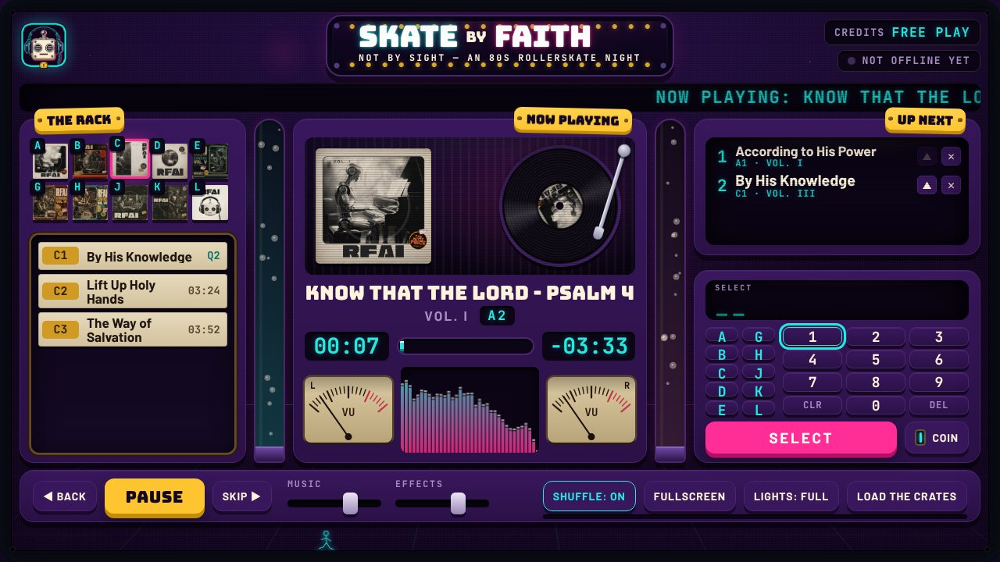

# Skate by Faith

**Not by Sight - An 80s Rollerskate Night**

An 80s arcade jukebox, presented by RFAI, that plays your playlist at the
roller-skate night.
It is a website that runs on **one laptop** plugged into the projector. No
accounts, no server, no database. You add songs by editing one file and uploading
MP3s.

Live address once switched on (see step 6). The repository is still named
`SkateNight`, so the address keeps that name; to change it, GitHub -> Settings ->
Repository name (the address changes with it):
`https://bhay95-collab.github.io/SkateNight/`



*(Screenshots in `docs/screenshots/` use stand-in covers and test tones, not your
real artwork or songs: power-on, INSERT COIN, choosing a song, now playing.)*

---

## What is in this folder

| Name | What it is | Do you touch it? |
|---|---|---|
| `tracks.js` | The list of albums (volumes) and songs | **Yes - the only file you edit** |
| `audio/` | The MP3 files | **Yes - upload songs here** |
| `covers/` | The album cover pictures | **Yes - upload covers here** |
| `sfx/` | Original mechanical effects; optional custom replacements | Only to swap a sound |
| `rfai-logo.png` | The RFAI headphone-robot logo | Only to swap it |
| everything else | The machine itself | No |

Each of `audio/`, `covers/` and `sfx/` has its own short README.

---

## 1. Get the MP3s out of Suno

Suno moves its buttons around from time to time, so if this does not match what
you see, look for a **Download** option on the song. At the time of writing:

1. Go to suno.com and sign in.
2. Open your **Library** and find the song.
3. Click the **three dots** (⋯) next to the song.
4. Click **Download**, then **MP3 Audio**.
5. The file lands in your computer's **Downloads** folder.

Do this for every song you want in the night. The files are usually 3-8 MB each.

## 2. Rename the files

The jukebox finds each song by its file name, so give every file a simple name:

- all **lower case**
- **no spaces** - use dashes instead
- no brackets or symbols
- ends in **`.mp3`**

| Suno gave you | Rename it to |
|---|---|
| `Rolling Thunder (1).mp3` | `rolling-thunder.mp3` |
| `Chrome Hearts v2.mp3` | `chrome-hearts.mp3` |

(On a Mac or Windows PC: click the file once, press **F2** on Windows or
**Return** on Mac, type the new name, press Enter.)

## 3. Upload the songs and covers to GitHub

1. Open your repository: `https://github.com/bhay95-collab/SkateNight`
2. Click the **`audio`** folder.
3. Click the **Add file** button (top right) -> **Upload files**.
4. Drag your renamed MP3s into the box (up to 100 at once).
5. Scroll down and click the green **Commit changes** button.

The covers for Vol. I to Vol. X are already in the **`covers`** folder.
For a new volume, do the same inside `covers` with a square `.jpg` named like
`vol-xi.jpg`.

> Limits: GitHub's website refuses a single file over **25 MB** (Suno MP3s are
> well under that). The whole site should stay under about **1 GB** - roughly 150
> songs. 80 songs is comfortable.

## 4. Add each song to `tracks.js` - worked example

You uploaded `rolling-thunder.mp3` and it belongs on **Vol. II**.

1. On GitHub, click **`tracks.js`**.
2. Click the **pencil icon** (Edit this file) at the top right of the file.
3. Find the `tracks = [` list near the bottom. Add a new line **inside the
   square brackets** (anywhere between `[` and `]`), copying the pattern exactly:

```js
  { id: 'rolling-thunder', title: 'Rolling Thunder', volume: 'vol-ii', file: 'audio/rolling-thunder.mp3' },
```

4. Click the green **Commit changes...** button (top right), then **Commit
   changes** again in the box that appears.
5. Wait about a minute, then reload the jukebox.

What each part means:

| Part | Meaning |
|---|---|
| `id: 'rolling-thunder'` | A nickname for the song. **Lower case, no spaces, different for every song.** |
| `title: 'Rolling Thunder'` | What appears on screen. Capitals and spaces are fine here. |
| `volume: 'vol-ii'` | Which album it belongs to. Must match an `id` in the `volumes` list above. |
| `file: 'audio/rolling-thunder.mp3'` | The file in the `audio` folder. **Must match the real file name exactly.** |

**The three rules:**

1. Keep the shape exactly: curly brackets `{ }`, **quote marks** around words,
   and a **comma at the end** of every line. A missing comma or quote is the
   number one thing that breaks the file.
2. Lines starting with `//` are notes for people. The computer ignores them.
3. **Never type a song length or a selection code.** The jukebox reads the
   length from the MP3 and makes the codes (A1, A2, B1...) from the *order* of
   the list.

**How the codes work:** each volume gets a letter in the order they are listed -
the first volume is **A**, the second **B**, and so on. Each song gets a number
in the order it appears within its volume. So the first Vol. II song is `B1`, because
Vol. II is the second volume in the list.

| Volume | I | II | III | IV | V | VI | VII | VIII | IX | X |
|---|---|---|---|---|---|---|---|---|---|---|
| Letter | A | B | C | D | E | **G** | **H** | **J** | **K** | **L** |

Notice the skipped letters: F, N, P and S are keyboard shortcuts (fullscreen,
next, previous, shuffle), and I and O are never used (they look like 1 and 0), so
Vol. VI is **G**, not F. This table is also written at the top of
`tracks.js`. Moving a song up or down the list changes its code.

**Where to put new songs:** spread them evenly, fewest songs first (right
now every album, Vol. I - X, has 7 songs, 70 in all; the next song goes on Vol. I). Add each new song at the **end** of the
`tracks = [` list, so no existing code changes. Each album has one complete
track list beneath a flexible cover: all current songs fit without turning pages.
The panel is tuned for seven songs per album: the list hugs its rows and every
spare bit of height goes to the album cover and the big album arrow keys. The
cover grows when the screen has spare room and shrinks before tracks do.
If a future album outgrows the window, scroll its list; typing a code brings
that song into view automatically.

**Adding a whole new album (volume):** add a line inside the `volumes = [` list:

```js
  { id: 'vol-xi', title: 'Vol. XI', cover: 'covers/vol-xi.jpg', accent: 'teal' },
```

`accent` is the colour of that album's little code chips and record label. Choose
one: `teal`, `mauve`, `gold`, `rust`, `wine`, `paper`, `sepia`.

Where you put the line matters: it sets the album's letter. Add new volumes at
the **end** of the list (Vol. XI becomes **M**). Putting one in the middle shifts
the letters, and so every song code, of the volumes after it.

**If you break something:** a red button appears in the top right of the jukebox
saying **CHECK TRACKS.JS**. Click it - it lists, in plain English, what is wrong
and which entry was skipped. The jukebox keeps running and only skips the broken
entry. If the whole file is broken it tells you that too.

**If a file is missing or misnamed:** that song shows **OUT OF ORDER** in the
rack, is skipped, and the rest carry on. (Your browser's developer console will
show grey "404" lines for missing files. That is normal and harmless.)

## 5. Add the RFAI logo

1. Make the logo a **512 x 512 pixel PNG with a transparent background**, named
   exactly **`rfai-logo.png`**.
2. On GitHub, open the repository's main page.
3. **Add file -> Upload files**, drag your `rfai-logo.png` in. Because the name
   is the same as the existing stand-in, it replaces it.
4. Click **Commit changes**.

It appears on the power-on screen, the INSERT COIN screen, the top-left of the
machine, and as the browser-tab icon. The headphone-robot logo is already in
place; follow these steps only if you want to swap it for a new one.

## 6. Switch on GitHub Pages (put it on the internet)

1. Open `https://github.com/bhay95-collab/SkateNight`.
2. Click **Settings** (the tab with a cog, along the top).
3. In the left menu click **Pages**.
4. Under **Build and deployment**, set **Source** to **Deploy from a branch**.
5. Under **Branch**, choose **`main`**, leave the folder as **`/ (root)`**, and
   click **Save**.
6. Wait 1-2 minutes and refresh the Pages screen. A box at the top says **"Your
   site is live at ..."** - that is the address for the venue laptop.

> The repository must be **public** for free GitHub Pages.

## 7. Night-of checklist

**The day before, at home or the venue, on the venue laptop:**

- [ ] Open the site in **Google Chrome** on the laptop:
      `https://bhay95-collab.github.io/SkateNight/` (the https address - the
      install below needs it).
- [ ] **Install it as an app (once per laptop):** Chrome's menu (the three
      dots, top right) -> **Cast, save and share** -> **Install page as app**
      (older Chrome: **Install Skate by Faith** or *Save and share* ->
      *Install*, or the small install icon at the right of the address bar).
      You get a **Skate by Faith** icon on the desktop / in the dock or Start
      menu, and the jukebox opens in its own window with no tabs or address bar.
- [ ] Open it from the new **Skate by Faith** icon. The dark cabinet appears;
      in the installed app Chrome normally allows the low hum to start by
      itself (no click needed). If the room stays silent, that is fine - the
      first click wakes it as usual.
- [ ] Click the dark cabinet (or press any key) - there is no button on purpose.
- [ ] Open **TOOLS** (bottom right), then press **LOAD THE CRATES**. The thin strip along the bottom of that button fills and the little
      light at the top right changes to **OFFLINE READY**. This saves every
      song on the laptop so the night runs even if the venue wifi dies. Press it
      again after you add songs. Then **test it offline**: turn the laptop's
      wifi off, close the app, open it from its icon again, and play a song.
- [ ] Press **START** and listen to a few songs.

**On the night:**

- [ ] Plug the laptop into **power** (important - it will run for hours).
- [ ] **Plug in the projector** and set the displays to **Duplicate / Mirror**
      (Windows: Windows key + **P** -> *Duplicate*. Mac: System Settings ->
      Displays -> *Mirror*). The one app window is both your controls and
      the room's picture.
- [ ] Turn off notifications on the laptop (so a pop-up never covers the screen).
- [ ] Open **Skate by Faith** from its icon. If the window still has a title
      bar, press **F** (or TOOLS -> **FULLSCREEN**) **before the audience
      arrives** - press **Esc** to leave. (On a dedicated event laptop a
      kiosk shortcut can launch it borderless: see *Fullscreen* below.)
- [ ] Click the dark cabinet (or press any key) to put the coin in. The
      machine wakes, goes dark, and the night's first song (**Praise Lifted On
      High**) starts in the dark; the jukebox appears on its second bar. Nobody
      presses START. Make sure that song is saved (**OFFLINE READY**) first.
- [ ] **Test volume beforehand**, not on the night (the music starts by itself): move the **MUSIC** slider (or tap the up/down arrow keys
      with the cabinet background focused)
      while someone stands at the back of the rink. The laptop's own volume
      should be about three-quarters up; use the jukebox slider to fine-tune.

**If the app is closed or reloaded by accident:** open it again from its icon
and click the dark cabinet (or press any key). The machine wakes again and the
next song starts by itself (the opening song isn't repeated in the same
window). The queue starts empty (the house rotation fills the gap).

**To hold the music** (for example to test the volume first, or for a rehearsal):
untick TOOLS -> **The Awakening starts the music**. The next time the page is
opened, the Awakening hands over to the old power-on screen and the jukebox
waits for **START**, exactly as before. Tick it again for the night.

**Picture and sound at the venue:** the jukebox appears when the song itself
reaches its second bar, allowing for the delay Chrome reports. Projectors and
sound desks add their own delays. If the picture lands visibly before or after
the beat in the room, the fix is one number (`REVEAL_OFFSET_MS` in app.js).

**Fullscreen:** the app asks Chrome for fullscreen, but desktop Chrome usually
opens installed apps in an ordinary app window with a title bar. Use **F** or
TOOLS -> FULLSCREEN before the audience arrives (it is not switched on by
itself mid-film, so the coin sequence never jumps). For a truly borderless
start on a dedicated machine, make a shortcut that runs Chrome with
`--kiosk https://bhay95-collab.github.io/SkateNight/` (close every other
Chrome window first; Alt+F4 / Cmd+Q to leave).

## How it behaves

- The site opens on the dormant cabinet: the jukebox standing almost
  invisible in a dark basement, its old picture tube the only light, and on
  it the little RFAI robot, faint and slowly breathing in the static. There
  are no instructions on purpose. Click, tap or press any key and everything
  goes still: the hum stops and the robot holds its breath, then looks toward
  the coin slot. The camera follows its look, the slot lamp catches and a
  small coin rises into the light and drops through the slot; you hear it
  fall for a long way, deep inside, while the camera tilts up the machine. A
  relay thumps, the machine tries to start, nearly makes it, dies, and sits
  dark. Then the robot lights up first, alone in the black screen, and the
  machine follows it: a heartbeat, quickening into the first song's tempo,
  and from a low angle, towering, the machine lights up and thumps in time
  for two bars - then cuts to black on the beat (about
  fifteen and a half seconds in all). A held breath, and the night's first
  song begins in the dark, on the same beat; one bar later, on the home chord,
  the jukebox is there, already playing. (With TOOLS -> *The Awakening starts
  the music* unticked, the old 6.5-second power-on screen plays instead and
  the jukebox waits for START.)
- **TOOLS** holds FULLSCREEN, LOAD THE CRATES, KEYBOARD SHORTCUTS, a Vinyl texture
  trim, an optional click-to-fill setting and *The Awakening starts the music*. Click it
  or use Enter/Space; Escape or a click outside closes it. Music, effects,
  shuffle and lights stay directly available on the deck.
- The music starts by itself after the Awakening (see above). **START** /
  **PAUSE** works as always; with the TOOLS setting unticked, START begins the
  house rotation by hand.
- **Pick a song by its code**, like a real jukebox. The left column is
  **PICK A SONG**: one album at a time, with a flexible sleeve above its complete
  track list. The selector sits beneath **UP NEXT** in the right column.
  Flip albums with the **arrow buttons** either side of the album name,
  or press a **letter key** (on screen or keyboard) - the rack jumps to that
  album. Then press the number and **SELECT** (or type it, for example `B`,
  `1`, `Enter`). The readout names the resolved song and prompts the next step
  before it is added. By default the title strips are for reading. In **TOOLS**,
  enable **Click a song to fill its code** to prefill a strip's code by clicking
  it or pressing Enter/Space while it is focused. This moves focus to **SELECT**;
  you still confirm the request with SELECT or Enter. The choice is remembered
  on that laptop. All current album tracks are visible together. A longer future album
  can be scrolled within its list. The chosen song joins **UP NEXT** above the
  selector, with confirmation of its position or that it is starting.
- **Smaller screens keep readable text.** The cabinet uses two columns on narrow
  windows and one column on phones, with page scrolling to reach every control.
  Normal laptop and projector windows retain the three-column cabinet. Album
  artwork still uses the space left after its complete track list.
- The scrolling LED strip under the sign rolls **one joke at a time**: skating,
  church and youth-group life, snacks and retro comedy. It draws from 234 lines
  (no repeats until every one has had a turn), with a separate set of 40 for
  when the music is stopped or paused. To add or
  change jokes, edit the `SKATE_JOKES` list in `copy.js`: ALL CAPS, 64
  characters at most, one per line in quote marks with a comma after.
- UP NEXT plays **first in, first out**. Its count includes every request, up to
  30. Scroll within the queue to inspect them all; a continuation cue appears
  when more remain below. Use the arrows to move a song up and the cross to
  remove one. Keyboard focus and the scroll position are retained while editing.
  The note says **Your picks play first. We'll keep the records turning.**
- When UP NEXT is empty, the **house rotation** picks the next song itself, so the
  rink is never silent. The **SHUFFLE** button chooses how:
  - **SHUFFLE: ON** (the default): a shuffled deck. **Every song plays once before
    any song repeats**, and a song never comes round again within 5 plays, even
    when the deck is reshuffled. Songs you pick yourself count as played.
  - **SHUFFLE: OFF**: plays in the order the songs are listed in `tracks.js`,
    then starts again at the top.

  Any spare rows in UP NEXT show the house's plan, greyed out under **IF NOBODY
  PICKS** - exactly the songs that will play, in order, if nobody chooses one.
  Pick one of those songs yourself and it moves up into your list instead.
  SHUFFLE is on every time the page loads.
- **SKIP** (or **N** / the right arrow) plays the next song straight away.
- **BACK** (or **P** / the left arrow): more than 3 seconds into a song it starts
  that song again; press it within the first 3 seconds (or twice) to go to the
  song that played before. The song you left goes to the **top of UP NEXT**, so
  SKIP brings you straight back to it. The machine remembers the last 50 songs.
- **Credits** are for show. A persistent **FREE PLAY** reminder confirms that
  requesting a song needs no payment, and the credits readout says FREE PLAY
  when the decorative credits run out.
- The **offline status** at the top is a button: press it to open TOOLS with
  **LOAD THE CRATES** focused. Saving starts only when you press LOAD THE CRATES.
- After **60 seconds** with nobody touching anything, the machine runs a light
  show. Touch any key to stop it.
- Switching songs fades out and in. You hear no hard cuts. The precision changer
  slows into its pickup position, lifts and transfers each record, then lowers
  the needle. The visible record spins at **45 rpm**.
- The coin animation and seven original mechanical sound effects accompany the
  keys, selection relay, changer, needle and page carrier. **Effects** has its own
  volume slider; custom MP3s in `sfx/` can replace individual sounds.
- Each record crackles like a played-in 45: soft hiss, warm crackle and the
  odd pop. When a record is changed the needle drops with a click and scrape,
  then the lead-in groove crackles for about **1 second** before the song
  starts. As a song fades out the crackle carries on (the run-out groove).
  **Effects** controls this texture alongside the cabinet sounds; **Music**
  does not touch it. The **Vinyl texture** slider in TOOLS turns down just the
  texture; **0%** removes vinyl (and the 1-second lead-in) without silencing
  cabinet sounds. Music, Effects and Vinyl texture show their current
  percentages. Resuming a paused song does not replay the needle drop.

### The machine's hum while it waits

In the **installed app** the hum starts by itself when the app opens, if
Chrome allows it (it normally does for installed apps). To keep the room
silent, press **Alt+Shift+D** (Option+Shift+D on a Mac) while the hum plays:
it stops, and stays off on later launches until you press it again.

In an ordinary browser tab it is optional:

Before the night, open the site with **?hum** on the end of the address
(for example `.../SkateNight/?hum`). The first tap, click or key press then
switches the hum on instead of putting the coin in: nothing appears on
screen, and within a few seconds a low electrical drone rises out of the
speakers and breathes with the little robot on the tube. The next press
wakes the machine as usual. This works on a phone or tablet too. Once
armed, the device remembers: next time, if the browser has not yet allowed
sound, the first press switches the hum on again rather than putting the
coin in. On a laptop you can instead press **Alt+Shift+D**
(on a Mac: Option+Shift+D) at any time before the coin; press it again to
switch it off. The laptop remembers, so after a reload (or next time, if
the browser allows this site sound) it hums by itself. Without it the
waiting screen is silent, as browsers require. Either way, when someone
touches the machine the hum stops dead - it holds its breath - and the
film's own power-up takes over. It follows the EFFECTS volume.

The opening plays the **extended cut (Bigger on the Inside)** by default:
the camera follows the coin into a huge dark interior, the first try fails
inside, and the machine rises back out through its own screen (about 18
seconds). For the shorter standard film (15.7 seconds), untick TOOLS ->
**Extended cut**; it changes from the next time the Awakening runs (reload
the page). To compare without changing the setting, add `?cut=standard` or
`?cut=extended` to the address.

To compare the opening with and without its old decoration (the coin's
spin and shine, falling dust, chrome glints, flickering dead neon letters),
open the site with **?ornament=all** on the end of the address; without it
they are left out. You can combine it with the hum: `?hum&ornament=all`.

### Keyboard

| Key | Does |
|---|---|
| **Space** | Play / pause |
| **N** or **Right arrow** | Next song |
| **P** or **Left arrow** | Back: restart this song, or press again for the previous one |
| **S** | Shuffle on / off |
| **F** | Fullscreen on / off |
| **Up / Down arrows** | Music volume up / down |
| **A-Z, 0-9, Enter** | Type a selection code, e.g. `B` `1` `Enter` |
| **Backspace / Esc** | Delete / clear the typed code |
| **?** | Show the key list again (it hides after a few seconds) |

These shortcuts respect the focused control. Enter/Space activate a focused
button or TOOLS disclosure, even with a song code pending. Up/Down scroll the
focused album list or queue. Left/Right inside the album rack browse albums;
transport arrows work on the cabinet background. Sliders, editing controls and
browser shortcuts retain their native keys. The diagnostic dialog contains
focus, blocks cabinet shortcuts, and returns focus to CHECK TRACKS.JS on closing.

Laptop **media keys** (play / pause / next / previous) work too.

### Lights

The machine is full of moving lights, always at full. The whole screen gently
swells with cyan/magenta edge light in time with the bass beat, and settles
when the music stops.

The effects are built to stay safe for people who are sensitive to flashing:
nothing flashes faster than three times a second, and music-driven lights swell
smoothly instead of strobing. Details are in `DESIGN.md`.

---

## If something goes wrong

| What you see | What to do |
|---|---|
| No sound at all | Click anywhere on the page (browsers need one click first). Check the MUSIC slider, the laptop volume, and that the tab is not muted. |
| A song says **OUT OF ORDER** | Its file is missing or the name in `tracks.js` does not match. Check the exact spelling and capitals. |
| Red **CHECK TRACKS.JS** button | Click it for a plain-English list. Usually a missing comma or quote. |
| **START-UP PROBLEM - PRESS F5** | Reload the page. If it keeps happening, tell whoever maintains the site. |
| New song does not appear | GitHub can take a minute or two to publish. Reload, then press LOAD THE CRATES again. |
| Light says **NOT OFFLINE YET** | Press the status, then **LOAD THE CRATES** while you have internet. |
| Light says **SAVED - NEEDS HTTPS** | The page was opened from a plain `http://` address. Use the GitHub Pages `https://` address. |
| No hum when the app opens | Chrome is holding sound back. It is fine: the first click wakes the machine with sound. To hear the hum before the night, see *The machine's hum while it waits*. |
| No **Install** option in Chrome's menu | Use the `https://` GitHub Pages address (not a saved file), and wait for the page to finish loading once. |

---

## For whoever maintains the code

- Static site: plain HTML + CSS + ES modules, no build step.
- Tests: `npm test` (uses Node's built-in test runner, nothing to install).
  Covers the queue, selection-code generation, tracks.js validation, the house
  rotation, the copy pools, the audio maths, keyboard routing, UI state and responsive
  artwork.
- To look at it locally: serve the folder with any static server that supports
  byte ranges (for example `npx http-server`) and open it in Chrome. Opening
  `index.html` straight from disk will not work (browsers block ES modules there).
- Optional browser regression checks use Playwright and a Chromium
  installation; these are developer tools, not application dependencies. With
  the local server running, use
  `python3 scripts/check-ui.py --base-url http://127.0.0.1:8080 --chromium /usr/bin/chromium`.
- Optional motion checks: `npm run test:motion` (with the local server running).
  `node --test` cannot see an animation, so every unit test passes just as
  happily with the rack flip broken. These assert the things that must not
  drift - the album cover and the title strips turning as one page, a turn
  being interruptible, CALM stopping motion at once - rather than the exact
  timings, which are meant to be tuned. They need Node Playwright
  (`npm i -D playwright && npx playwright install chromium`) and exit 2, not 1,
  when it is missing.
- `DESIGN.md` records the material system, palette, motion rules, safety rules
  and the reasoning behind the reliability design (including why songs are played
  from Blob URLs instead of through the service worker).
- `docs/UI-REVIEW.md` records the UI review, the implemented usability changes,
  historical measurements and the tradeoffs behind the chosen layouts.
- The page exposes `window.__skateNight` (state + player) for tests and for
  debugging in the console. The night does not depend on it.

### What was tested, and what was not

The following records the earlier playback and venue preparation checks.
The UI review documents the subsequent usability pass; the optional browser
regression script checks its keyboard, queue, settings and responsive behavior.

Tested (headless Chromium via Playwright, 1280x720 plus 1920x1080, 1440x900,
1366x768 and 1024x768; served like GitHub Pages including from a `/SkateNight/`
sub-path):

- `npm test` covers the queue, codes, `tracks.js` validation,
  house rotation and shuffle deck, in-order mode, copy pools, audio maths,
  CSS safety rules, unskippable arrival, and sound assets/fallbacks.
- Boot, INSERT COIN, selection by keyboard / keypad code, UP NEXT, house
  rotation, record changer frames, now-playing readouts, idle attract mode.
- Natural song change: about 40 ms between songs. Skip: about 1.2-1.4 s (the
  record changer working). Pause / resume, volume keys.
- CALM lights from the OS setting and from the switch (no animations running
  at all; choice remembered across reload).
- A missing MP3 (OUT OF ORDER, skipped, house rotation avoids it) and a broken
  `tracks.js` (red CHECK TRACKS.JS button, site still alive).
- LOAD THE CRATES, then the network switched off: the page reloads and songs
  play from the saved copy.
- Soak: 14 minutes of continuous play including about 70 skips and queue
  changes: JavaScript memory flat at 2-3 MB, page elements and running
  animations constant, console clean.
- No horizontal scrolling at any of the sizes above.

**Not tested (needs a real laptop and projector):** real speakers (sound was
checked through the machine's own level meters, not by ear), the laptop's
media keys, real fullscreen and screen-sleep prevention (the headless browser
refuses the wake lock), a three-hour run, Safari and Firefox, and performance on
a genuinely slow laptop (the headless browser draws in software, so it is a
pessimistic stand-in). Please do a 10-minute run-through on the venue laptop a
day before.

